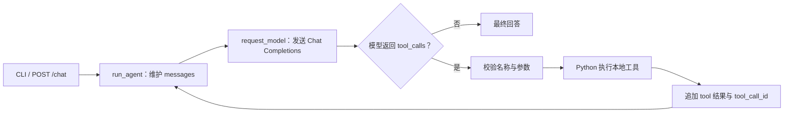

# Mini Tool Calling Agent

一个用于学习 Python Agent 工作原理的小项目。模型通过 SiliconFlow 的 OpenAI 兼容 Chat Completions 接口提出工具调用请求；本地 Python 校验参数、执行工具，再把结果送回模型。项目保留了 CLI 和 FastAPI 两种入口，不依赖 LangChain、数据库或前端。

## 核心功能

- `calculator`：安全解析数字、括号及加减乘除表达式，不使用 `eval()`。
- `get_order_status`：查询固定的**模拟订单** `ORD-1001`、`ORD-1002`。
- Agent 循环：模型可连续请求工具；Python 按白名单执行并用 `tool_call_id` 配对结果。单次提问最多执行 5 次工具调用。
- 同一 CLI 会话或同一 HTTP `session_id` 可连续对话；离线测试使用假模型和模拟 HTTP 响应。



模型决定是否请求工具，但不会直接运行本地 Python。工具说明并非安全边界；真正的白名单、参数检查和调用次数限制位于 `agent.py`。

## 项目结构

```text
mini-agent/
├── agent.py                 # Agent 循环、工具说明与分发
├── tools.py                 # 计算器与模拟订单
├── request_model.py         # SiliconFlow HTTP 请求与 .env 加载
├── main.py                  # CLI 入口
├── web_app.py               # FastAPI 入口、进程内会话与锁
├── requirements.txt         # 直接依赖
├── .env.example             # 无真实密钥的配置示例
└── tests/                   # unittest 离线测试
```

## 环境安装与配置

建议使用 Python **3.11 或更新版本**。以下命令在 Windows PowerShell 中从项目根目录执行：

```powershell
cd mini-agent
python -m venv .venv
.\.venv\Scripts\python.exe -m pip install -r requirements.txt
Copy-Item .env.example .env
```

编辑项目根目录的 `.env`，把 `SILICONFLOW_API_KEY` 的占位值替换为你自己的 Key；`SILICONFLOW_BASE_URL` 和 `SILICONFLOW_MODEL` 按所用服务配置。当前示例为：

```dotenv
SILICONFLOW_API_KEY=your_api_key_here
SILICONFLOW_BASE_URL=https://api.siliconflow.cn/v1
SILICONFLOW_MODEL=deepseek-ai/DeepSeek-V4.1-Flash
```

不要把真实 Key 写入源码、测试或 Issue，也不要提交 `.env`。真实模型请求需要可用的 Key、网络和模型额度，可能产生费用。离线测试不需要真实 Key。

## CLI：连续对话

```powershell
.\.venv\Scripts\python.exe -B main.py
```

可输入“请计算 2+3*4”或“请查询 ORD-1001 的状态”，随后继续追问。同一 CLI 进程中的输入共享对话历史；输入 `/clear` 清空当前会话，输入 `exit` 或 `quit` 退出。每次启动 CLI 都是新会话。

## FastAPI：HTTP 接口

```powershell
.\.venv\Scripts\python.exe -m uvicorn web_app:app --host 127.0.0.1 --port 8000
```

本地打开 `http://127.0.0.1:8000/docs` 可交互测试。接口如下：

| 方法与路径 | 用途 |
| --- | --- |
| `GET /health` | 返回 `{"status":"ok"}`；仅表示进程可响应，不检查模型服务 |
| `POST /chat` | 接收消息并返回回答与会话 ID |
| `GET /docs` | FastAPI 自动生成的交互文档 |

在 `/docs` 或 Apifox 向 `POST http://127.0.0.1:8000/chat` 发送：

```json
{"message":"请查询 ORD-1001 的状态"}
```

响应形如 `{"session_id":"生成的ID","answer":"..."}`。继续对话时带上返回的 ID：

```json
{"session_id":"生成的ID","message":"刚才查的是哪个订单？"}
```

若提供尚不存在的 `session_id`，服务会创建该会话；不同 ID 的消息历史相互独立。无效请求返回 HTTP 422，Agent 或模型请求失败返回 HTTP 502。同一会话的并发请求由进程内锁串行处理。

## 离线测试

```powershell
.\.venv\Scripts\python.exe -B -m unittest discover -s tests -v
```

测试覆盖工具输入、Agent 循环和消息配对、跨轮历史、HTTP 请求构造及 FastAPI 接口；模型和 HTTP 响应均由测试替身提供，不会访问真实模型或产生 API 费用。

## 已知限制

- 订单均为固定模拟数据，不连接真实业务系统。
- 会话只保存在单个进程的内存中；重启会丢失，多进程部署时各进程不会共享历史。
- HTTP 接口没有身份认证，客户端可以指定 `session_id`。**当前不适合直接公开部署为多用户服务。**
- 没有生产级 Token、会话长度、请求速率或累计费用控制；`max_tool_calls` 只限制一次提问中的工具次数。
- 没有 RAG、数据库、会话持久化或流式输出。真实模型是否选择工具由模型决定，程序只执行它实际返回且通过校验的工具调用。
